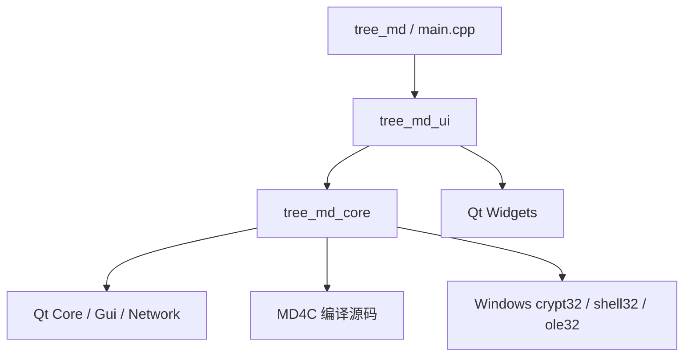
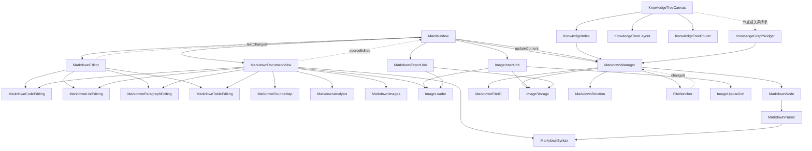
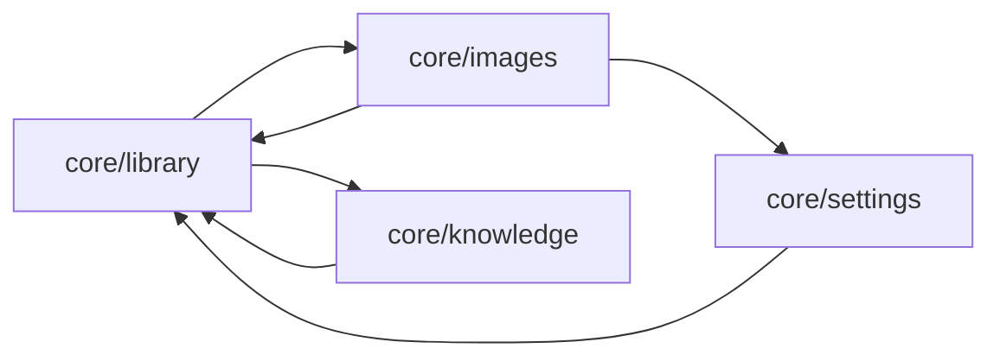
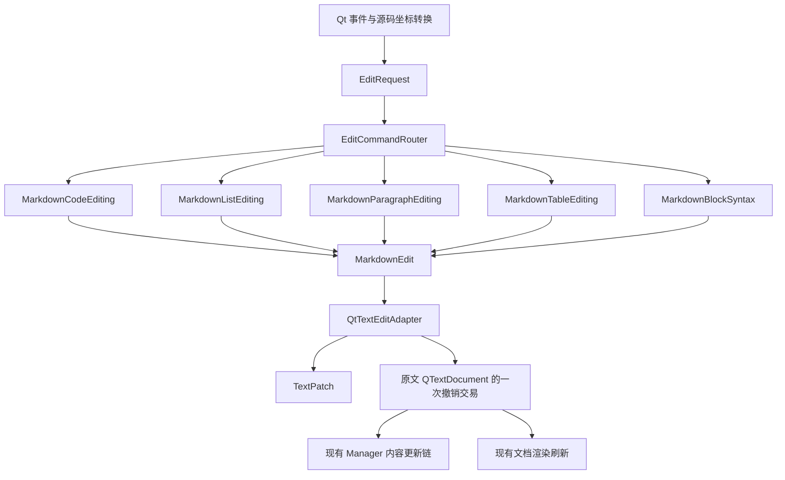
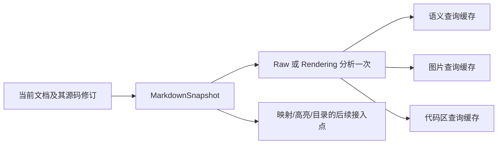
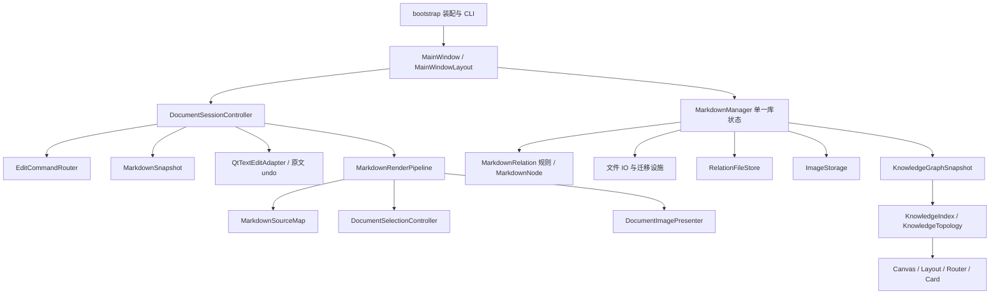

# 当前调用关系与分层后的模式

箭头含义按图分别说明。调用图展示已核查的主要路径，不声称列出 Qt 虚调用、信号槽和动态事件的完整运行时调用图；包含依赖数据另见 inventory.json。

## 1. 当前构建依赖

箭头表示“依赖/链接”，不是函数调用。

这两个静态库已经将 Widgets 排除在核心之外。`core` 当前包含规则、业务流程和平台设施，因此它仍是较粗的边界，不能称为只含纯算法的领域库。

## 2. 当前主要类调用

实线表示直接方法调用；虚线表示信号/事件触发的间接调用。

主要证据位置：

| 路径 | 源码位置 | 含义 |
| --- | --- | --- |
| 文档编辑 → 原文撤销 → 节点更新 | [MainWindow.cpp:168](D:/PC/Project/Qt/tree_md/ui/MainWindow.cpp:168)、[MainWindow.cpp:231](D:/PC/Project/Qt/tree_md/ui/MainWindow.cpp:231) | sourceEdited 用一次 QTextCursor 交易更新原文；textChanged 再更新 Manager |
| 原文按键 → 多类编辑规则 | [MarkdownEditor.cpp:70](D:/PC/Project/Qt/tree_md/ui/document/MarkdownEditor.cpp:70) | Table、List、Code、Prefix、Paragraph 按优先级分发 |
| 文档按键 → 多类编辑规则 | [MarkdownDocumentView.cpp:968](D:/PC/Project/Qt/tree_md/ui/document/MarkdownDocumentView.cpp:968) | 先处理可视表格、隐藏符号与选区，再分发源码交易 |
| 渲染 → 共用语义和映射 | [MarkdownDocumentView.cpp:122](D:/PC/Project/Qt/tree_md/ui/document/MarkdownDocumentView.cpp:122)、[MarkdownSourceMap.cpp:52](D:/PC/Project/Qt/tree_md/core/markdown/MarkdownSourceMap.cpp:52) | 重建包含分析、图片、Qt 导入、表格锚点、空白恢复和装饰 |
| 知识索引反向读取管理器 | [KnowledgeIndex.cpp:2](D:/PC/Project/Qt/tree_md/core/knowledge/KnowledgeIndex.cpp:2) | 当前 KnowledgeIndex::build 接受 MarkdownManager 引用 |
| 关系规则同时读写文件 | [MarkdownRelation.cpp:90](D:/PC/Project/Qt/tree_md/core/knowledge/MarkdownRelation.cpp:90)、[MarkdownRelation.cpp:134](D:/PC/Project/Qt/tree_md/core/knowledge/MarkdownRelation.cpp:134) | 领域角色运算和持久化仍在同一类 |

## 3. 当前目录包含依赖环

以下是源码 `#include` 聚合到目录后的强连通部分，不表示函数递归，也不表示 CMake 存在无法链接的循环。

成因分别是管理器调用图片交易、图片存储调用文件 IO、知识索引读取管理器、关系 JSON 调用文件 IO、设置持久化也调用库目录中的 IO。应先分离“规则/状态”和“文件设施”的职责，再迁目录；直接改文件夹名称不能消除这些依赖。

## 4. 本轮草案形成的编辑链

已生成的代码使用 `tmd::proposal` 命名空间并独立编译，尚未替换现有事件处理函数。

`QtTextEditAdapter` 应用于原文 QTextDocument，不能直接用于内容已被渲染的 QTextBrowser。文档视图先把显示选区转换为源码位置；其图片两步删除、方向键可视折行、IME、隐藏符号命中仍属于 Qt 适配层。

Raw 与 Rendering 是两种不同语义，不能混用。真实源码与已插入临时标记的 renderSource 也必须是不同快照。本轮代码没有伪称已经接入 SourceMap、表格分析或整篇渲染流程。

## 5. 完整目标模式

下面是完成后续分阶段改造后的目标调用关系。灰色概念在此用名称表达，尚未全部生成代码。

运行时调用设施允许从 application 指向 infrastructure；若继续拆为严格的可替换依赖，才为“关系存储、文件交易”等真正存在替换或故障注入需求的边界定义接口，并由 bootstrap 注入。无需给每个 QString 工具函数创建接口。

## 6. 需要保持的调用契约

1. `MarkdownManager` 继续唯一持有节点和关系，不另建一套镜像 Manager。
2. 一次用户编辑只进入一次原文 undo 交易；选区和前后光标随同一交易恢复。
3. 表格优先于代码、列表和普通段落；文档/原文模式的分隔规则明确作为参数。
4. 文件改名/移动、图片改写、关系写入仍是一组可回退的工作；不能拆成互不协调的独立保存。
5. 异步图片结果带文档身份和代次，切文档/重载后不写入旧光标。
6. 集合、标题、保存状态、关系分别使用现有信号粒度；不要恢复成“所有变化都全量刷新”。
