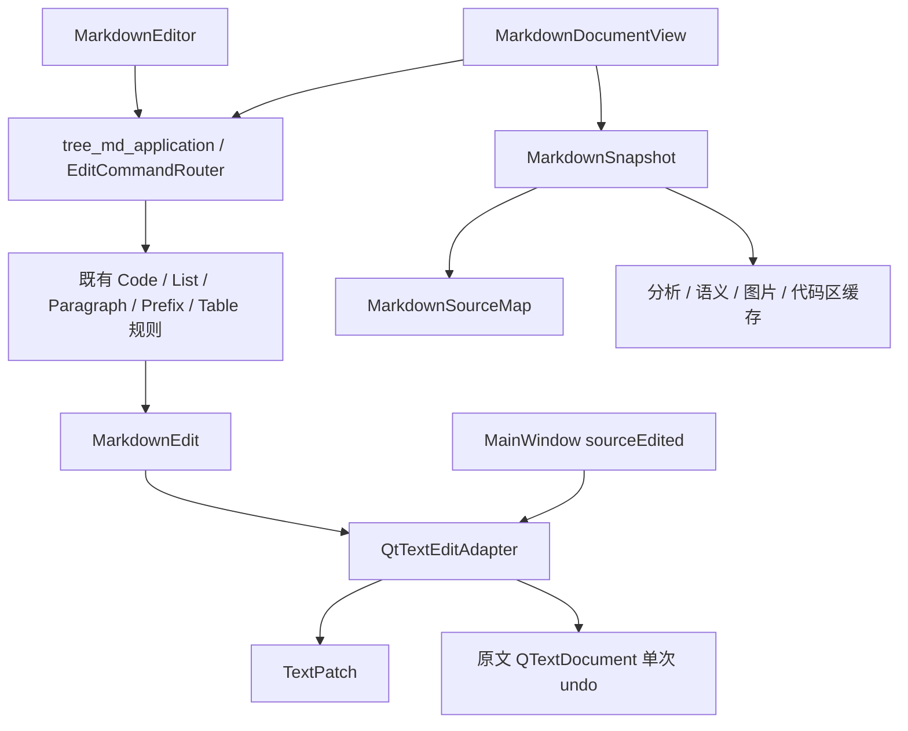

# 模块化编辑优化实施记录

## 已接入的结构

```text
tree_md/
├── application/
│   └── editing/
│       ├── EditCommandRouter.h       # 命令、模式、选区和表格地址
│       └── EditCommandRouter.cpp     # 共用核心编辑分发顺序
├── core/markdown/
│   ├── analysis/
│   │   ├── MarkdownSnapshot.h        # 指定 Raw/Rendering 的不可变原文
│   │   └── MarkdownSnapshot.cpp      # 分析、语义、图片、代码区惰性结果
│   ├── editing/
│   │   ├── TextPatch.h               # UTF-16 单段替换值对象
│   │   └── TextPatch.cpp             # 共用前后缀差分与代理对边界
│   └── MarkdownSourceMap.h/.cpp      # 共享快照，源码更新时失效
├── ui/
│   ├── document/
│   │   ├── QtTextEditAdapter.h       # 原文 Qt 交易与历史光标接口
│   │   ├── QtTextEditAdapter.cpp     # 预期原文校验、一次 undo、选区
│   │   ├── MarkdownEditor.h/.cpp     # 按键适配后调用统一路由
│   │   └── MarkdownDocumentView.h/.cpp # 渲染/映射共用快照，编辑调用路由
│   └── MainWindow.cpp                # 复用文本交易并记录前后光标
└── tests/
    └── ModularEditingTests.cpp       # Unicode、undo、快照失效与固定输入结果
```

这批修改在既有目录中增加真实模块，不整体移动已有 core/ui 文件；目标 `src/` 结构仍是后续迁移设计。`proposals/modular-editing` 保留审查草案，正式应用使用项目根目录中的实现。

接入后当前清单包含 145 个 C/C++ 源文件与头文件，共 17,525 行；[实际完整目录](D:/PC/Project/Qt/tree_md/docs/optimization-review/2026-10-18/integrated/CURRENT-STRUCTURE.md) 和 [更新后的目标目录](D:/PC/Project/Qt/tree_md/docs/optimization-review/2026-10-18/integrated/TARGET-STRUCTURE.md) 单独保存，初始 136 文件的审查基线不覆盖。

## 当前调用模式



## 行为约束

- 语法规则保持不变，沿用已确认的 N55 空行、标题、列表、代码区和表格规则。
- 表格键、源码选区、隐藏符号、IME 和可视方向键仍由 Qt 视图负责转换。
- 普通源码编辑与文档编辑的退格优先级及分隔模式分别保留。
- 原文预期值不匹配、changed 标记错误或选区越界时拒绝交易并经现有错误通道提示。
- 同一不可变原文可共享解析结果；不同内容、Raw 模式与 Rendering 模式不混用。
- 缓存随当前原文修订失效，不建立全库解析缓存；常驻解析结果会增加当前文档内存占用，端到端收益和峰值内存仍需在后续大文档实测中评估。
- 渲染后的 QTextDocument 继续独立重建，不能把原文交易适配器用于已隐藏 Markdown 符号的显示文档。

## 验证记录

本次正式接入的 Debug 全目标构建成功，**15 组完整回归全部通过、0 失败、0 跳过**，约 421.7 秒。新增模块化专项 **23 项通过**（含初始化/清理）；原有语法规则、文件移动、图片、知识树和设置检查均通过。

| 检查 | 实际结果 |
| --- | --- |
| 统一路由 | 8 组输入使用固定原文/光标结果核对，实际原文编辑器调用正式路由后均一致 |
| Unicode / 文本替换 | 169 对语料替换、500 组固定种子随机序列、UTF-16 代理对边界均通过 |
| Qt 原文交易 | 单步 undo/redo、只移光标不新增 undo、过期交易拒绝、文档交易前后光标均通过 |
| 解析快照 | 重建与空白恢复共用一次分析；内容变化、过期快照和 Raw/Rendering 不匹配时正确失效或拒用 |
| 层依赖 | 核心不包含 application/UI，应用层不包含 Widgets/UI；所有新增编译源均显式登记 CMake |
| 改动保留 | 既有工作区修改先备份；本批未改写已有语法规则实现，MarkdownSourceMap 只接入查询快照 |
| Debug 入口 | `scripts/Start-Debug.ps1 -CheckOnly` 通过，桌面 Tmd Debug 继续启动本次编译结果 |

完整机器记录见 [implementation-verification.json](D:/PC/Project/Qt/tree_md/docs/optimization-review/2026-10-18/implementation-verification.json)，JUnit 记录为 [modular-integration-full.xml](D:/PC/Project/Qt/tree_md/build/Desktop_Qt_6_11_1_MinGW_64_bit_Debug/modular-integration-full.xml)。本批修改前的 207 份源码/资料备份在 [architecture-integration-20261018-152555](D:/PC/Project/Qt/tree_md/package/architecture-integration-20261018-152555)。

初次审查阶段的 3 组回归和草案 20 项检查保留在原 verification.json，不与这次接入结果混用。本批没有宣称完成 Windows 原生 IME/字体画面验收或测得端到端提速比例。

## 后续结构工作

文档视图的渲染阶段/选择控制器、知识图只读输入、关系存储、配置声明拆分及全量目录迁移尚未实施；这批接入不把它们计作已完成。
