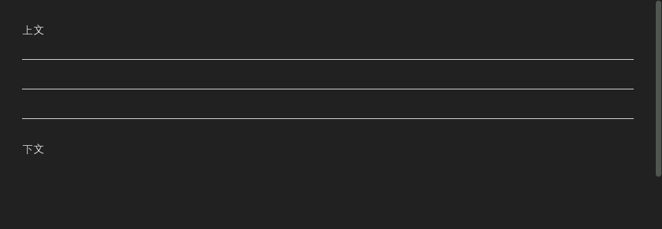
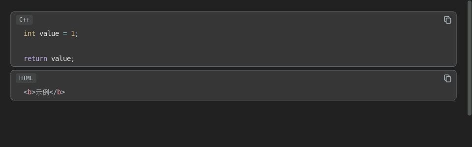
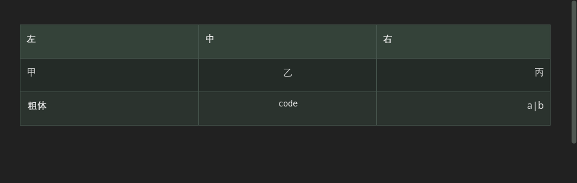
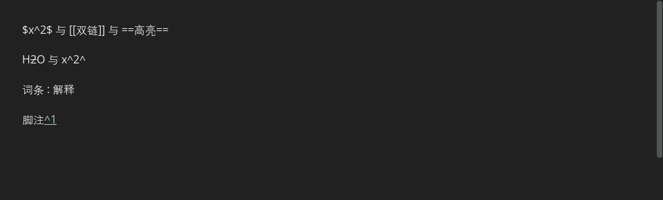

# Tmd 文档编辑语法确认模板

记录日期：2026-10-15。问询已完成，应用逻辑已按本轮规则重构；验证进度见 [IMPLEMENTATION.md](IMPLEMENTATION.md)。

文档视图是 Markdown 原文的可编辑呈现。原文是唯一内容依据；展示层不得擅自吞掉普通空格、换行或文字。

完整性复核：30 类格式、N01–N54 目标规则及既有 P01–P13 已整理，Q43–Q51 及补充澄清全部回答。本轮重构及验证已完成，结果见 [IMPLEMENTATION.md](IMPLEMENTATION.md)。卡片截图仍是旧实现的参考。

## 如何使用

以下卡片保留问询时的原文、历史加载截图与讨论重点，供对照使用；“当前加载参考”“待描述的重点”描述的是采样时状态，不代表仍有待回答的问题。最终目标以 [RULES.md](RULES.md) 为准，实际实现与验证以 [IMPLEMENTATION.md](IMPLEMENTATION.md) 为准。截图不覆盖光标进入、输入中或鼠标拖选的全部状态。

标记约定：`▏` 是光标、`⟦文字⟧` 是选区；它们不写入 MD。可见字符对照中的 `␠` 是一个普通空格、`⇥` 是一个 Tab、`↵` 是一个换行；实际原文代码框仍保留真实空白。

## 每条规则的答复格式

不必逐字段填表，可以直接自然语言描述，我负责整理。涉及边界时优先给一个具体例子。

- 语法编号、规则编号：
- 光标位置、是否有选区：
- 操作前的原文（代码框，保留空白）：
- 操作前的文档表现：
- 按键或鼠标操作：
- 希望得到的原文（代码框）：
- 希望得到的文档表现与光标位置：
- 还原、撤销、重新加载后应保持什么：
- 例外情况：

```text
示例编号：S06 / Backspace / 有缩进空项

操作前（▏仅表示光标）：
    - ▏

操作：Backspace 一次

期望原文：
- ▏

期望文档表现：
减少一级缩进，仍显示空列表项，光标留在该项正文位置。
```

## 每类语法都检查的操作

| 维度 | 需要说明的情况 |
| --- | --- |
| 生成 | 每个字符输入、触发空格、闭合符号、Enter、粘贴、中文提交分别何时触发预览 |
| 空白 | 前缀必要空格、额外空格、行首/行尾空格、Tab、一个/多个换行、只含空格的空行 |
| Enter / Shift+Enter | 正文开始、中间、末尾、空内容、有选区；生成的源码与视觉行数 |
| Backspace | 正文起点、空项、缩进后、上一行是别的语法、隐藏符号边界；逐次按键结果 |
| Delete | 行末与下一行、标记前、选区内/跨块；是否合并块或恢复原始符号 |
| Tab / Shift+Tab | 无选区、整行、多行、列表嵌套、代码缩进、表格跳格 |
| 光标 | Left/Right/Up/Down、Home/End；是否能进入标记；点击可见空行与行末空白 |
| 鼠标 | 单击、双击、长按拖选、跨格式框选；框选期间符号展示与选区范围 |
| 剪贴板 | 复制显示内容还是源码；剪切；粘贴纯文本/多行/含格式内容；图片替换 |
| 输入法 | 中文组合输入期间、提交、替换已有文字；不要把未提交文本作为完成语法 |
| 状态转换 | 完整 → 不完整 → 恢复；输入符号后取消预览；前后正文不被吸收 |
| 持久性 | Ctrl+Z / Ctrl+Y、Ctrl+S、切换原文/文档、重开文件；内容和光标对应一致 |

## 讨论顺序

1. S01–S02、S15、S30：空格、换行和缩进的总规则。
2. S03–S11：标题、分隔线、列表、任务和引用。
3. S12–S14、S29：行内格式、代码和未完成输入。
4. S16–S18：表格生成、单元格编辑和退出表格。
5. S19–S24：链接、图片、转义和实体。
6. S25–S28：HTML、注释、元数据及扩展的支持范围。
7. 对所有项目执行上述组合操作矩阵，确认跨语法优先级。

## 清单

| 编号 | 格式 | 状态 |
| --- | --- | --- |
| S01 | 普通正文、空格与空行 | 按 G02/G03、N01/N03；普通空白保留 |
| S02 | 显式硬换行 | 尾部空格保留；有效转义沿用既有语义和 N39 原文编辑 |
| S03 | 井号标题 H1–H6 | 中间 Enter、起点 Backspace 已确认；其它有效标记沿用既有语义 |
| S04 | 下划线式标题 Setext | 已确认至少三个等号/减号、即时生成、退格、Down 展开及仅紧邻上一行成标题 |
| S05 | 分隔线 | 下方退格整条删除、Up/Down 展开标记已确认 |
| S06 | 无序列表 | 拆项、退格、源码分隔已确认；父子缩进联动按 N47 |
| S07 | 有序列表 | 保留手写编号；新项续号沿用当前数字加一；层级联动按 N47 |
| S08 | 任务列表 | 切换及新任务状态已确认；空任务恢复符号后整体清除前缀（N45） |
| S09 | 嵌套列表与同项续段 | 空项续写及退格清理已确认；父项与全部子项联动（N47） |
| S10 | 引用与嵌套引用 | 单层操作已确认；嵌套逐层退出（N46） |
| S11 | 组合容器 | 既有例外继续有效；嵌套逐层退出（N46），跨块局部删除保护剩余代码区（N52） |
| S12 | 强调、加粗、删除线及嵌套 | 手动配对、光标进入显示符号、拆段恢复正文不补齐已确认 |
| S13 | 行内代码 | 手动配对、拆段恢复原文不补齐已确认；框选规则继续有效 |
| S14 | 围栏代码块 | Enter 或主动选定提示创建（N48）；跨块局部删除保留剩余代码区结构（N52）；其余既有规则有效 |
| S15 | 缩进代码块 | 手动四空格只作缩进；外部导入及普通粘贴均转为围栏代码（N43/N49） |
| S16 | 完整表格与对齐 | 初始一格；键盘及右键规则已确认；格首退格无操作、唯一空格子退格删整表（N50） |
| S17 | 不完整表格与省略边界 | 文档和原文同步补齐为完整矩形表格（N51/N53） |
| S18 | 表格单元格内换行 | Enter 格内换行、Shift+Enter 新增行，后者为最新例外 |
| S19 | 行内链接与文档链接 | 单击编辑、Ctrl+单击打开、光标进入显示原文已确认 |
| S20 | 引用式链接与定义 | 定义平时隐藏、方向键到原位展开已确认 |
| S21 | 自动链接 | 点击按 N32；识别边界沿用现有支持范围 |
| S22 | Markdown 图片与图片链接 | 两步退格删引用、双击显示完整原文已确认 |
| S23 | 引用式图片与 HTML 图片 | 引用定义方向键展开；HTML img 原文显示 |
| S24 | 转义字符与实体 | 进入展开原始拼写、按源码逐字符编辑已确认 |
| S25 | 原生 HTML | 全部原文呈现；表格 br 格内换行例外 |
| S26 | HTML 注释 | 随 HTML 全部原文呈现，修正旧隐藏残留 |
| S27 | 文首 YAML 元数据 | 手动配对后加载可编辑区域；单独文首横线 Enter 继续正文（N38/N54） |
| S28 | 未启用的扩展 | 沿用既有功能范围，本轮不新增扩展语法 |
| S29 | 未完成或不合法的输入 | 按 P11、N18 等保留原文；中文组合及撤销属于实现检查 |
| S30 | 块之间的空行与光标 | 按 G02/G03、N01/N10；跨块局部删除保护剩余代码区结构（N52） |

## S01 普通正文、空格与空行

语法格式：普通字符；行内/行首/行尾空格；单次换行、连续空行。

原文：

``````markdown
甲  乙
丙

丁


戊
``````

空白字符对照（只用于观察，不是 MD 源码）：

``````text
甲␠␠乙↵
丙↵
↵
丁↵
↵
↵
戊
``````

当前加载参考：普通换行在当前导入中可能合并为空格；连续空行不能逐行显示。新要求：非语法空白按原文显示。


待描述的重点：行首/空行退格合并哪一行；空格和 Tab 的显示宽度。

答复记录：2026-10-15 用户确认一次 Enter 直接到下一行，见 [RULES.md / N01](RULES.md)。当前截图是修复前现状，尚未按新规则重构。


## S02 显式硬换行

语法格式：行尾两个空格再换行，或反斜杠再换行；HTML br 另见 S18/S25。

原文：

``````markdown
甲  
乙\
丙
``````

空白字符对照（只用于观察，不是 MD 源码）：

``````text
甲␠␠↵
乙\↵
丙
``````

当前加载参考：实测：两种形式均换行；第一种的两个尾部空格仍出现在可编辑文本中，反斜杠被隐藏。需明确目标中哪些空格属于语法。


待描述的重点：尾部空格是否保持可见宽度及逐字符光标位置；退格先删换行还是还原符号。

答复记录：2026-10-15 用户已确认两个行尾空格正常保留，参见 [RULES.md / N03](RULES.md)。文档页保留空格宽度及编辑位置，光标可经过、Backspace 可逐个删除；实际换行符负责换行。反斜杠等明确标记的行为另行确认。


## S03 井号标题 H1–H6

语法格式：行首 1–6 个 # 加普通空格；可有结尾的空格和 #。

原文：

``````markdown
# 一级
## 二级
### 三级
#### 四级
##### 五级
###### 六级

##   保留额外空格  ##
``````

空白字符对照（只用于观察，不是 MD 源码）：

``````text
#␠一级↵
##␠二级↵
###␠三级↵
####␠四级↵
#####␠五级↵
######␠六级↵
↵
##␠␠␠保留额外空格␠␠##
``````

当前加载参考：标题字号分级，前缀在预览中隐藏；进入标记时可显示。第一个空格触发预览，其余正文空格保留。


待描述的重点：结尾 ## 是否继续支持；多个标题块的选区、Delete 与组合容器行为。

答复记录：2026-10-15 已确认中间 Enter 保留前半标题、后半进入正文，且不额外加空行（N04）；有文字时正文起点 Backspace 恢复完整原始井号并保留文字（N05），原文 `## ▏标题` 变为 `##▏标题`。详见 [RULES.md](RULES.md)。


## S04 下划线式标题 Setext

语法格式：正文下一行放 === 或 ---，形成一级或二级标题；与分隔线有上下文歧义。

原文：

``````markdown
一级标题
===

二级标题
---
``````

空白字符对照（只用于观察，不是 MD 源码）：

``````text
一级标题↵
===↵
↵
二级标题↵
---
``````

当前加载参考：下方符号行被标题语义吸收；紧贴文字的 --- 不是分隔线。


目标规则：至少三个等号或三个减号，分别生成一级和二级标题；仅紧邻上一行成为标题。生成、退格还原及 Down 展开真实符号采用同一规则。

答复记录：2026-10-15 已确认双向即时转换（N06）；标题开头首次 Backspace 删除 ---，下一次才将文字并到上一行；标题行 Down 展开已有 ---，光标移至末尾（N07）。Q42.2 确认多个正文行中仅紧邻 --- 的上一行成为二级标题（N42）。Q42.1 最新回答“和---一个标准”（N44），等号式至少三个等号，编辑规则与减号式一致，仅标题级别不同。详见 [RULES.md](RULES.md)。


## S05 分隔线

语法格式：独立行的 ---、***、___；同类符号之间可有空格；与上文空行决定部分语义。

原文：

``````markdown
上文

---

***

_ _ _

下文
``````

空白字符对照（只用于观察，不是 MD 源码）：

``````text
上文↵
↵
---↵
↵
***↵
↵
_␠_␠_↵
↵
下文
``````

当前加载参考：分隔线绘制为横线；单个 - 保持原文。



待描述的重点：独立横线触发时机；Enter；额外空格和多个连续横线；其它分隔符的行为。

答复记录：2026-10-15 已确认横线后空行 Backspace 删除整条横线；从下方 Up 或上方 Down 显示原始 ---，光标停末尾；紧邻上一行补文字则转标题（N08）。展开是显示已有源码，不另插入新符号。详见 [RULES.md](RULES.md)。


## S06 无序列表

语法格式：-、+、* 后跟普通空格。

原文：

``````markdown
- 第一项
- 第二项

+ 加号项

* 星号项
``````

空白字符对照（只用于观察，不是 MD 源码）：

``````text
-␠第一项↵
-␠第二项↵
↵
+␠加号项↵
↵
*␠星号项
``````

当前加载参考：显示项目符号；已有 Enter 续项、空项退出和退格恢复前缀规则。


待描述的重点：行首/行末 Enter；符号种类；跨项选区。

答复记录：2026-10-15 已确认中间 Enter 拆为两项，新项光标在文字最前；Backspace 有缩进先退一级，无缩进且有文字时删除项目标记及空格，下一次 Backspace 才并回上一行（N09）。空项仍按此前规则恢复完整符号。退出列表时按需补一个必要的源码语法分隔空行，文档页不额外显示；更多空行照常显示（N10）。详见 [RULES.md](RULES.md)。


## S07 有序列表

语法格式：1. 或 1) 加空格；数字允许 1–9 位；起始编号和上下文影响识别。

原文：

``````markdown
1. 第一项
2. 第二项

3) 第三项
4) 第四项
``````

空白字符对照（只用于观察，不是 MD 源码）：

``````text
1.␠第一项↵
2.␠第二项↵
↵
3)␠第三项↵
4)␠第四项
``````

当前加载参考：显示编号列表；输入续项由核心逻辑处理。


待描述的重点：新项续写编号；首项不是 1 的触发规则；空项与编号标记的退格。

答复记录：2026-10-15 已确认手写编号原样显示，原文 1、3 就显示 1、3；增删项目不自动改写已有数字（N11）。详见 [RULES.md](RULES.md)。


## S08 任务列表

语法格式：列表标记后加 [ ]、[x] 或 [X]，方括号后再跟普通空格。

原文：

``````markdown
- [ ] 待完成
- [x] 已完成
- [X] 大写标记
``````

空白字符对照（只用于观察，不是 MD 源码）：

``````text
-␠[␠]␠待完成↵
-␠[x]␠已完成↵
-␠[X]␠大写标记
``````

当前加载参考：显示任务状态标记；去掉最后触发空格后恢复完整原始符号。


待描述的重点：有正文时逐次退格；中间拆分任务；状态标记的直接输入。

答复记录：2026-10-15 已确认单击任务框直接切换并同步该项原文状态（N12）；已完成任务末尾 Enter 生成未勾选新任务，保留原任务状态，光标在新项正文起点（N13）。详见 [RULES.md](RULES.md)。


## S09 嵌套列表与同项续段

语法格式：列表内缩进形成子项；续段/代码的归属依赖父项与缩进。

原文：

``````markdown
- 父项
    - 子项
        - 孙项

    父项后续段

- 下一项
``````

空白字符对照（只用于观察，不是 MD 源码）：

``````text
-␠父项↵
␠␠␠␠-␠子项↵
␠␠␠␠␠␠␠␠-␠孙项↵
↵
␠␠␠␠父项后续段↵
↵
-␠下一项
``````

当前加载参考：嵌套层级影响缩进；已有 Tab/Shift+Tab 和正文起点 Backspace 退一级规则。


待描述的重点：缩进单位；多行选区与父子项联动；不同列表标记的混合。

答复记录：2026-10-15 已确认空子项 Enter 续同缩进空项（N14）；Backspace 依次为退一级缩进、显示原始减号、当前行转普通正文（N16）；退缩进同时删除紧接的连续同原缩进空项整行，遇有文字项停止（N19）。详见 [RULES.md](RULES.md)。


## S10 引用与嵌套引用

语法格式：> 加普通空格；重复 > 构成嵌套。

原文：

``````markdown
> 第一段
> 
> 第二段

> > 内层引用
``````

空白字符对照（只用于观察，不是 MD 源码）：

``````text
>␠第一段↵
>␠↵
>␠第二段↵
↵
>␠>␠内层引用
``````

当前加载参考：显示引用背景/缩进；普通引用 Enter 续引用，空引用 Enter 回正文。


待描述的重点：嵌套引用退出层级；省略 > 的续行是否支持；多行选区。

答复记录：2026-10-15 已确认单层引用有文字时，正文起点 Backspace 删除 > 和触发空格，文字留在当前行成为正文（N15）；单层空引用 Enter 结束引用、进入正文（N17）。详见 [RULES.md](RULES.md)。


## S11 组合容器

语法格式：引用中放标题/列表/代码；列表中放引用/代码，前缀可叠加。

原文：

``````markdown
> ### 引用标题
> 
> - 引用中的列表

- 外层列表

  > 列表中的引用
``````

空白字符对照（只用于观察，不是 MD 源码）：

``````text
>␠###␠引用标题↵
>␠↵
>␠-␠引用中的列表↵
↵
-␠外层列表↵
↵
␠␠>␠列表中的引用
``````

当前加载参考：同一行可属于多个容器；引用中的标题结束 Enter 已确认退出引用到正文。


待描述的重点：中间 Enter/Backspace 的优先级；只去除最内层还是全部；标记是否同时展示。

答复记录：本项已纳入最终 [RULES.md](RULES.md)；通用边界及未启用扩展范围见 [完整性复核](OPEN-QUESTIONS.md)，没有新增待回答项目。


## S12 强调、加粗、删除线及嵌套

语法格式：*斜体*、_斜体_、**加粗**、__加粗__、***组合***、~~删除线~~。

原文：

``````markdown
*斜体* 和 _斜体_

**加粗** 和 __加粗__

***粗斜体*** 与 ~~删除线~~

**外层 *内层* 外层**
``````

空白字符对照（只用于观察，不是 MD 源码）：

``````text
*斜体*␠和␠_斜体_↵
↵
**加粗**␠和␠__加粗__↵
↵
***粗斜体***␠与␠~~删除线~~↵
↵
**外层␠*内层*␠外层**
``````

当前加载参考：字体呈现相应格式；下划线拼写表示斜体/加粗。额外发现：当前渲染还会把单波浪线 ~内容~ 显示成删除线（见 S28 的 H~2~O），但核心行内边界收集按双波浪线处理，存在规则不一致。


待描述的重点：空内容；边界输入和跨格式选区；嵌套格式。

答复记录：2026-10-15 已确认手动配对渲染（N18），光标进入显示真实标记并保留格式（N20）；Enter 拆段后原标记分段保留，不补齐，恢复普通字体（N21/N22）。详见 [RULES.md](RULES.md)。


## S13 行内代码

语法格式：同长度反引号配对；多反引号可包住含反引号的文本。

原文：

``````markdown
正文 `a  b` 后文

``含 ` 的代码``
``````

空白字符对照（只用于观察，不是 MD 源码）：

``````text
正文␠`a␠␠b`␠后文↵
↵
``含␠`␠的代码``
``````

当前加载参考：等宽字体和圆角底色；光标进入/选取时可显示原始定界符。


待描述的重点：框选期间标记独立；首尾空格/跨行规范化是否保留；空代码、拆开反引号后的表现。

答复记录：2026-10-15 已确认行内代码手动配对渲染（N18），框选仍按 P08；Enter 后原两端反引号分居两段，恢复普通原文，不补齐（N23）。详见 [RULES.md](RULES.md)。


## S14 围栏代码块

语法格式：至少三个反引号或波浪线；开始行可带语言；Tmd 要求有闭合围栏。

原文：

``````markdown
```cpp
int value = 1;

return value;
```

~~~html
<b>示例</b>
~~~
``````

空白字符对照（只用于观察，不是 MD 源码）：

``````text
```cpp↵
int␠value␠=␠1;↵
↵
return␠value;↵
```↵
↵
~~~html↵
<b>示例</b>↵
~~~
``````

当前加载参考：独立代码面板，左上语言、右上复制、按语言高亮。补全新块仅创建空代码体，不吞后文。



待描述的重点：进入/退出块；首行和尾行空行删除；Tab/Shift+Tab；围栏语言编辑；长度更长的围栏。

答复记录：本项已纳入最终 [RULES.md](RULES.md)；通用边界及未启用扩展范围见 [完整性复核](OPEN-QUESTIONS.md)，没有新增待回答项目。


## S15 缩进代码块

语法格式：独立段落前四个空格或 Tab，可能被识别为代码；列表内需结合容器。

原文：

``````markdown
    第一行
    第二行

普通正文
``````

空白字符对照（只用于观察，不是 MD 源码）：

``````text
␠␠␠␠第一行↵
␠␠␠␠第二行↵
↵
普通正文
``````

当前加载参考：当前解析器保留缩进代码语义；与“普通行首空格也要显示”的新原则需要明确边界。


目标规则：普通正文四个行首空格保留为普通缩进，不自动生成代码区。外部导入时按标准 Markdown 识别实际缩进代码，转换为反引号围栏，只转换导入副本；代码内部缩进和后续正文保留。列表、表格、代码内部 Tab 采用已确认的各自规则。

答复记录：2026-10-15 用户先确认新代码区前后三反引号，中间一行空代码体，后面补一行空正文；向下到代码区底部可退出（N02）。Q40 澄清后选择普通四空格只作缩进，并要求“外部导入的这种语法导入时自动变成反引号的代码块”（N43）；导入后与围栏代码使用相同代码区样式，没有语言信息时不猜语言。详见 [RULES.md](RULES.md)。当前截图是重构前的历史基线，新实现状态见 IMPLEMENTATION.md。


## S16 完整表格与对齐

语法格式：表头 + 分隔行；管道分列；:--- / :---: / ---: 控制对齐。

原文：

``````markdown
| 左 | 中 | 右 |
| :--- | :---: | ---: |
| 甲 | 乙 | 丙 |
| **粗体** | `code` | a\|b |
``````

空白字符对照（只用于观察，不是 MD 源码）：

``````text
|␠左␠|␠中␠|␠右␠|↵
|␠:---␠|␠:---:␠|␠---:␠|↵
|␠甲␠|␠乙␠|␠丙␠|↵
|␠**粗体**␠|␠`code`␠|␠a\|b␠|
``````

当前加载参考：渲染成网格，首行表头；单元格可含行内格式和转义竖线。



待描述的重点：载入残缺格式；跨格选区与粘贴；删除表头但仍保留其它行的处理。

答复记录：2026-10-15 已确认创建一行一列、空格触发（N24/N25）；Tab 换格、Shift+Tab 当前列右插列、Shift+Enter 当前行下增行（N26/N28）；方向键格内先移动再跨格（N27）；整表末格 Tab、底部 Down 都进入下方正文（N29/N31），无正文则补输入行；删唯一行/列后整表消失、原处留正文行（N30）。右键删行列，Enter 仍格内换行。详见 [RULES.md](RULES.md)。


## S17 不完整表格与省略边界

语法格式：GFM 允许省略行首/行尾管道；缺列、额外列、孤立管道有不同解释。

原文：

``````markdown
甲 | 乙
--- | ---
内容

| 尚未成表

后文
``````

空白字符对照（只用于观察，不是 MD 源码）：

``````text
甲␠|␠乙↵
---␠|␠---↵
内容↵
↵
|␠尚未成表↵
↵
后文
``````

当前加载参考：首尾管道不完整不一定非法；缺少的格可以是虚拟格。已有缺格输入定位处理。


待描述的重点：载入残缺表格时的列数及边界；取消表格；后续正文。新表自动补后侧管道符已由 N24 确认。

答复记录：本项已纳入最终 [RULES.md](RULES.md)；通用边界及未启用扩展范围见 [完整性复核](OPEN-QUESTIONS.md)，没有新增待回答项目。


## S18 表格单元格内换行

语法格式：单元格内 <br>、<br/>、<br /> 转成格内换行；物理源码行仍是一行。

原文：

``````markdown
| 内容 | 备注 |
| --- | --- |
| 第一行<br>第二行 | 示例 |
``````

空白字符对照（只用于观察，不是 MD 源码）：

``````text
|␠内容␠|␠备注␠|↵
|␠---␠|␠---␠|↵
|␠第一行<br>第二行␠|␠示例␠|
``````

当前加载参考：采样时 Enter/Shift+Enter 都在格内换行，生成 <br>；最新目标 N24 已改为 Enter 格内换行、Shift+Enter 新增表格行，截图为旧行为对照。


待描述的重点：格内连续 Enter、起点退格和普通单格粘贴；Tab/换行网格粘贴已由 N40 确认。

答复记录：Enter 格内换行沿用 P07；Shift+Enter 新增表格行（N24）覆盖旧全局规则；含 Tab 分列、换行分行的文本粘贴按网格填入，缺行列自动扩展（N40）。详见 [RULES.md](RULES.md)。


## S19 行内链接与文档链接

语法格式：[文字](目标)；可附标题；目标可为网址、相对文档或锚点。

原文：

``````markdown
[网页](https://example.com "说明")

[文档](other.md) 与 [位置](#section)
``````

空白字符对照（只用于观察，不是 MD 源码）：

``````text
[网页](https://example.com␠"说明")↵
↵
[文档](other.md)␠与␠[位置](#section)
``````

当前加载参考：按链接样式显示标签；编辑器关闭默认自动打开，需要单独约定点击行为。


待描述的重点：删空标签、格式失效；选区粘贴网址；引用定义入口。

答复记录：2026-10-15 已确认单击编辑、Ctrl+单击打开（N32），光标进入显示完整原始 Markdown，直接修改文字与目标（N33）。详见 [RULES.md](RULES.md)。


## S20 引用式链接与定义

语法格式：[文字][编号]、[编号][]、[编号] 配合 [编号]: 目标。

原文：

``````markdown
[文字][ref]、[ref][]、[ref]

[ref]: https://example.com "说明"
``````

空白字符对照（只用于观察，不是 MD 源码）：

``````text
[文字][ref]、[ref][]、[ref]↵
↵
[ref]:␠https://example.com␠"说明"
``````

当前加载参考：定义行通常不显示，多个标签共享目标；是隐藏源码的一类。


待描述的重点：跨定义选区；编辑共享定义时的定位。保留标准引用关系。

答复记录：2026-10-15 已确认定义平时隐藏、方向键进入真实原文位置时展开编辑；引用式图片同样处理（N36）。详见 [RULES.md](RULES.md)。


## S21 自动链接

语法格式：<https://example.com>、裸网址、www 域名和邮件地址。

原文：

``````markdown
<https://example.com>

https://example.com

www.example.com

writer@example.com
``````

空白字符对照（只用于观察，不是 MD 源码）：

``````text
<https://example.com>↵
↵
https://example.com↵
↵
www.example.com↵
↵
writer@example.com
``````

当前加载参考：GitHub 方言开启宽松网址/邮件自动链接。


待描述的重点：何时识别完整链接；标点是否纳入；回退到普通文字的办法；点击/双击/修饰键行为。

答复记录：本项已纳入最终 [RULES.md](RULES.md)；通用边界及未启用扩展范围见 [完整性复核](OPEN-QUESTIONS.md)，没有新增待回答项目。


## S22 Markdown 图片与图片链接

语法格式：；图片可被 [图片](链接) 包裹；路径支持本地/网络/内嵌数据。

原文：

``````markdown


[](https://example.com)
``````

空白字符对照（只用于观察，不是 MD 源码）：

``````text
↵
↵
[](https://example.com)
``````

当前加载参考：加载可用资源为图片；资源缺失时显示错误占位。样例使用随模板提供的本地 SVG。


待描述的重点：图片前后 Enter、粘贴替换、尺寸与说明。

答复记录：2026-10-15 已确认图片后两步 Backspace 删除引用、保留文件（N34）；双击显示完整原始图片 Markdown 直接编辑（N35）。详见 [RULES.md](RULES.md)。


## S23 引用式图片与 HTML 图片

语法格式：![说明][编号] + 定义；以及 。

原文：

``````markdown
![说明][photo]

[photo]: assets/sample.svg


``````

空白字符对照（只用于观察，不是 MD 源码）：

``````text
![说明][photo]↵
↵
[photo]:␠assets/sample.svg↵
↵

``````

当前加载参考：实测：引用式图片正常显示；同一示例的 HTML img 没有产生第二张可见图片。图片发现支持 HTML src，不代表文档呈现同样完整支持。


待描述的重点：共享定义的修改范围；尺寸是否写回 HTML；删除展示图片时如何处理引用定义。

答复记录：本项已纳入最终 [RULES.md](RULES.md)；通用边界及未启用扩展范围见 [完整性复核](OPEN-QUESTIONS.md)，没有新增待回答项目。


## S24 转义字符与实体

语法格式：反斜杠转义 Markdown 标点；&amp;、&#35;、&nbsp; 等实体。

原文：

``````markdown
\# 普通井号

\*不是强调\* 与 \`不是代码\`

&amp; &#35; &nbsp;
``````

空白字符对照（只用于观察，不是 MD 源码）：

``````text
\#␠普通井号↵
↵
\*不是强调\*␠与␠\`不是代码\`↵
↵
&amp;␠&#35;␠&nbsp;
``````

当前加载参考：转义符/实体源码可映射成更少的显示字符。


待描述的重点：与其它格式边界相邻时的定位；失效实体回到字面文本；原始拼写保留。

答复记录：2026-10-15 已确认进入时展开原始转义/实体，按源码逐字符编辑，不一次吞掉整个实体（N39）。详见 [RULES.md](RULES.md)。


## S25 原生 HTML

语法格式：Qt 富文本支持的 HTML 子集；不等于浏览器完整 HTML。

原文：

``````markdown
<b>HTML 粗体</b> 后文

甲<br>乙

<div>HTML 区块</div>
``````

空白字符对照（只用于观察，不是 MD 源码）：

``````text
<b>HTML␠粗体</b>␠后文↵
↵
甲<br>乙↵
↵
<div>HTML␠区块</div>
``````

当前加载参考：实测：<b> 粗体生效；普通正文中的 <br> 后的“乙”和后续 div 内容未出现在显示文本中。属于当前 HTML 导入缺陷，不能作为目标规则。


待描述的重点：按原文保留 HTML 的空格、换行和所有内容；不再使用会吞后文的原生 HTML 导入方式。

答复记录：2026-10-15 用户明确 HTML 全部原文呈现（N37）；表格里的 br 仍作为已确认格内换行语法。截图是旧行为对照。详见 [RULES.md](RULES.md)。


## S26 HTML 注释

语法格式：<!-- 注释 -->；可跨行。

原文：

``````markdown
上文

<!-- 隐藏注释
第二行 -->

下文
``````

空白字符对照（只用于观察，不是 MD 源码）：

``````text
上文↵
↵
<!--␠隐藏注释↵
第二行␠-->↵
↵
下文
``````

当前加载参考：实测缺陷：这段跨行注释的“第二行 -->”泄漏到上文后，而非完整隐藏。核心会排除注释图片，但显示侧仍存在不一致；目标按 N37 全部显示原文。


待描述的重点：多行注释整体原样显示、定位与选择，完整保留内容。

答复记录：HTML 注释按 N37 的“HTML 全部原文呈现”处理，不再部分隐藏；此前残留“第二行 -->”的截图为待修正旧行为。详见 [RULES.md](RULES.md)。


## S27 文首 YAML 元数据

语法格式：文件开头 --- 换行，内容，再由独立 --- 行闭合。

原文：

``````markdown
---
title: 示例
tags: [写作, 规范]
---

正文
``````

空白字符对照（只用于观察，不是 MD 源码）：

``````text
---↵
title:␠示例↵
tags:␠[写作,␠规范]↵
---↵
↵
正文
``````

当前加载参考：识别为文首元数据，正文预览不显示；内部图片/标题不按正文解释。


待描述的重点：区分真正的文首元数据与普通分隔线；未闭合时保留字面文本；加载不能自动改写源码。

答复记录：2026-10-15 用户要求类似代码块的内部编辑，上下 --- 始终隐藏，点入或方向键进入也不显示；删除导致内部内容全部为空时连同边界删除（N38）。属性内部按其代码块类比可见并可编辑；采样截图为整个块隐藏的旧行为。详见 [RULES.md](RULES.md)。


## S28 未启用的扩展

语法格式：公式、Wiki 双链、脚注、==高亮==、上/下标、定义列表等没有专门实现。

原文：

``````markdown
$x^2$ 与 [[双链]] 与 ==高亮==

H~2~O 与 x^2^

词条
: 解释

脚注[^1]

[^1]: 说明
``````

空白字符对照（只用于观察，不是 MD 源码）：

``````text
$x^2$␠与␠[[双链]]␠与␠==高亮==↵
↵
H~2~O␠与␠x^2^↵
↵
词条↵
:␠解释↵
↵
脚注[^1]↵
↵
[^1]:␠说明
``````

当前加载参考：实测：公式、Wiki、高亮、上标均未启用；H~2~O 被当成单波浪线删除线；脚注拼写被普通引用链接识别，并没有脚注语义。Mermaid/LaTeX 围栏只作为代码着色，不生成图/公式。



待描述的重点：这些格式需保持字面文本还是纳入未来需求；先确认范围，不默认添加新语法。

答复记录：本项已纳入最终 [RULES.md](RULES.md)；通用边界及未启用扩展范围见 [完整性复核](OPEN-QUESTIONS.md)，没有新增待回答项目。


## S29 未完成或不合法的输入

语法格式：未配对行内符号、无触发空格的前缀、未配对代码围栏。

原文：

``````markdown
##

-

- [ ]

**尚未闭合

```cpp
不是已闭合代码块
``````

空白字符对照（只用于观察，不是 MD 源码）：

``````text
##↵
↵
-↵
↵
-␠[␠]↵
↵
**尚未闭合↵
↵
```cpp↵
不是已闭合代码块
``````

当前加载参考：实测：这些不完整标记保留为文本；未配对代码围栏后的普通换行却被折叠成空格，与本轮保留换行要求冲突。


待描述的重点：补齐/删掉哪个字符触发或取消预览；输入法组合期间是否暂停转换；撤销按字符还是按整次转换。

答复记录：本项已纳入最终 [RULES.md](RULES.md)；通用边界及未启用扩展范围见 [完整性复核](OPEN-QUESTIONS.md)，没有新增待回答项目。


## S30 块之间的空行与光标

语法格式：标题、表格、正文等相邻时，源码空行既可能分隔结构，也可能是用户留白。

原文：

``````markdown
## 7.解析漏洞
| 文件类型 | 十六进制头文件 | ASCII表现 |
| --- | --- | --- |


 
## 8.条件竞争
``````

空白字符对照（只用于观察，不是 MD 源码）：

``````text
##␠7.解析漏洞↵
|␠文件类型␠|␠十六进制头文件␠|␠ASCII表现␠|↵
|␠---␠|␠---␠|␠---␠|↵
↵
↵
␠↵
##␠8.条件竞争
``````

当前加载参考：已修正表格外空段的源码光标位置，但原文多个空行仍未完整逐行呈现。


待描述的重点：所有留白是否逐行可点；哪个换行是结构分隔；点击空白行、Backspace 和选区跨表格的结果。

答复记录：本项已纳入最终 [RULES.md](RULES.md)；通用边界及未启用扩展范围见 [完整性复核](OPEN-QUESTIONS.md)，没有新增待回答项目。


## 代码语言标记补充

代码语言改变标题标签和着色，不改变代码块的 Enter、Backspace、缩进与围栏规则。

现有补全项：plaintext、python、cpp、c、csharp、java、javascript、typescript、js、ts、sql、bash、shell、powershell、html、css、scss、json、yaml、xml、markdown、go、rust、kotlin、php、swift、ruby、vue、dockerfile、ini、toml、diff、mermaid、latex。

常见别名：c++/cc/cxx/hpp/hxx → cpp；c#/cs → csharp；py/python3 → python；js/jsx → javascript；ts/tsx → typescript；sh/shell/zsh → bash；ps1/pwsh → powershell；htm/xhtml/markup → html；svg → xml；yml → yaml；md → markdown；text/txt/plain/none/空标记 → plaintext。语言名不区分大小写。未知语言保留标签并作为无专属着色的代码。

Mermaid 和 LaTeX 的语言名只选择代码着色，不代表已经集成图形或数学排版。每种语言内部的编程语法不另作为 Markdown 语法询问。

## 证据与范围

- 语义来源：`core/markdown/MarkdownSyntax.cpp`、`MarkdownAnalysis.cpp`、`MarkdownBlockSyntax.cpp`、`MarkdownImages.cpp`、`MarkdownTableEditing.cpp`。
- 编辑来源：`MarkdownListEditing.cpp`、`MarkdownCodeEditing.cpp`、`ui/document/MarkdownDocumentView.cpp`、`MarkdownFenceCompleter.cpp`、`MarkdownSourceMap.cpp`。
- 既有确认与测试：`docs/EDITING_AUDIT.md`、`tests/Editing*AuditTests.cpp`。
- 30 项覆盖当前通用语法族及主要交互边界，不声称穷举所有组合。任意 HTML/CSS/第三方 Markdown 扩展不属于已保证支持的语法。
- `catalog.json` 保存原文样例与问题；`render-observations.json` 保存本轮实际渲染的文本和块类型。
- 截图由独立程序链接现有 Debug 核心/UI 库，实例化实际 `MarkdownDocumentView` 生成；使用隔离设置与公开示例，不访问个人笔记，不覆盖正在运行的 Tmd。
- HTML、图片、引用定义等存在部分兼容行为；以实际截图/块观察为参考，不将浏览器 Markdown 效果冒充 Tmd 实测。
