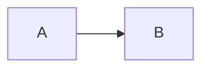

# md语法详解与正文对照

本文是 [md语法基础](md语法基础.md) 的下节点。按“前缀描述、前后声明、其他”三个类别介绍写法；每项说明后紧接原文代码段，再给出正文效果或明确标注的效果说明。代码段用于展示 MD 原文，不会执行其中的内容。

范围包括常用 Markdown、表格/任务/删除线等扩展，以及 Tmd 对空白、元数据、HTML 和未启用扩展的处理。具体按键操作按相同顺序放在 [tmd输入指南](tmd输入指南.md)。

## 一、前缀描述

这一类主要通过行首标记决定这一行或这一组内容的结构。标记后的第一个空格属于语法，后续普通空格属于正文。

### 1.1 井号标题

行首一至六个 `#` 加空格表示 H1–H6。标题可以包含行内格式，行尾也可使用与正文隔开的结束井号。

```markdown
# 一级示例
## 二级示例
### 三级示例
#### 四级示例
##### 五级示例
###### 六级示例
### 带 **重点** 的标题 ###
```

正文效果：标题按层级显示，井号不作为正文显示。下面展示四级标题和带重点的三级标题。

#### 四级示例

### 带 **重点** 的标题

### 1.2 无序列表、嵌套与同项续段

`- `、`+ `、`* ` 都可引出无序项目。缩进表示子项目；属于同一项的续段、引用或代码应对齐到该项的内容区域。Tmd 中用 Tab 调整层级比手工计算空格更方便。

```markdown
- 主项目
    - 第二层
        - 第三层
- 另一项目

+ 另一种标记
* 也可使用星号

- 一个有续段的项目

    这段仍属于同一个项目。
```

正文效果：项目有列表标记，子项目向内缩进，续段仍依附于所属项目。

- 主项目
    - 第二层
        - 第三层
- 另一项目

Tmd 的无序列表第一层显示实心圆，第二层显示空心圆，第三层及以后显示小圆点；正文文字不随圆点缩小。

### 1.3 有序列表

数字后接 `.` 或 `)`，再接空格，表示有序项目。Tmd 保留原文数字，不因为项目位置变化而统一重排；层级的显示样式与原文编号分开处理。

```markdown
1. 第一步
3. 保留手写编号
    1. 第二层项目
    2. 另一子项
        1. 第三层项目

1) 另一种编号分隔符
2) 继续下一项
```

正文效果：Tmd 顶层按原文显示数字；第二层数字以 a、b、c 等字母呈现，原文仍保存数字；第三层及以后显示小圆点。

1. 第一步
3. 保留手写编号
    1. 第二层项目
    2. 另一子项
        1. 第三层项目

普通 Markdown 阅读器可能自动显示连续编号；比较文件内容时，以 MD 原文为准。直接写 `a. ` 不是 Tmd 的有序列表输入方式。

### 1.4 任务列表

列表前缀后加 `[ ] ` 表示未完成，加 `[x] ` 或 `[X] ` 表示已完成。方括号内的普通空格是未完成状态的一部分。

```markdown
- [ ] 阅读语法说明
- [x] 完成基础练习
- [ ] 整理文档
    - [ ] 检查链接
```

正文效果：显示可以切换状态的任务框。Tmd 中单击任务框会同步修改原文状态。

- [ ] 阅读语法说明
- [x] 完成基础练习
- [ ] 整理文档
    - [ ] 检查链接

### 1.5 引用、嵌套与组合容器

行首 `> ` 表示引用，连续多个引用前缀表示嵌套。引用里可放列表、标题、代码等；列表里也可放引用，组合时同时保留各层前缀或必要缩进。

```markdown
> 第一层引用
> > 第二层引用
>
> - 引用中的列表
> - 另一项目

- 一个项目
    > 项目中的引用
```

正文效果：引用带有独立的缩进与背景，内层引用和列表继续显示各自的结构。

> 第一层引用
> > 第二层引用
>
> - 引用中的列表
> - 另一项目

## 二、前后声明

这一类用开始和结束标记界定范围。通常是行内范围；代码块和文首元数据是单独列出的多行特例。

### 2.1 斜体与粗体

一对星号或下划线表示斜体，两对表示粗体。Tmd 的下划线标记表示强调，不表示给文字画下划线；符号紧贴需要格式化的内容。

```markdown
*星号斜体* 与 _下划线斜体_
**星号粗体** 与 __下划线粗体__
```

正文效果：

*星号斜体* 与 _下划线斜体_

**星号粗体** 与 __下划线粗体__

### 2.2 组合强调与嵌套

三个星号或下划线可组合粗体与斜体，不同格式也可嵌套；结束标记按嵌套的相反顺序闭合。

```markdown
***同时加粗和倾斜***
___另一种组合写法___
**外层粗体，_内层斜体_，回到粗体**
```

正文效果：

***同时加粗和倾斜***

**外层粗体，_内层斜体_，回到粗体**

### 2.3 删除线

前后各两个波浪号 `~~` 表示删除线，常用于标记过时内容。教程统一使用双波浪号；不要把 `H~2~O` 当作可靠的下标写法。

```markdown
~~已经不再采用的方案~~
**保留结论**，~~删除旧描述~~。
```

正文效果：

~~已经不再采用的方案~~

**保留结论**，~~删除旧描述~~。

### 2.4 行内代码与反引号

短代码用前后成对的反引号包住。反引号是 `` ` ``，英文单引号 `'` 只是普通引号；内容包含一个反引号时，可用两个反引号作为外层标记。

```markdown
使用 `Ctrl+S` 保存，变量名是 `count`。
``内容里有一个 ` 反引号``
'普通单引号' 不生成代码样式。
```

正文效果：使用 `Ctrl+S` 保存，变量名是 `count`。代码显示等宽字体和底色，内部的星号等符号不继续作为强调标记。

``内容里有一个 ` 反引号``

'普通单引号' 不生成代码样式。

### 2.5 代码块：前后声明的多行特例

代码块把开始围栏、代码正文、结束围栏分别放在独立行。推荐三反引号，也可使用至少三个波浪号；前后符号种类一致，结束围栏不能短于开始围栏。起始行的语言名用于选择高亮。

````markdown
```cpp
int count = 3;
return count;
```

~~~html
<p>学习 Markdown</p>
~~~
````

正文效果：形成独立代码面板，左上显示语言，右上提供复制按钮，正文按语言着色；普通 Markdown 标记在代码里按原样显示。

```cpp
int count = 3;
return count;
```

要展示三反引号原文本身，外层可用四反引号，避免内层围栏提前结束外层代码段。本文上面的原文展示即采用这种方式。

标准 Markdown 还存在四个行首空格的缩进代码写法。Tmd 手动输入四空格只保留普通缩进；外部文件导入或普通粘贴中的实际缩进代码会转换成围栏代码区。

```text
    first();
    second();
```

这段用于展示“每行前四个空格”的原文，不表示在 Tmd 文档页按四次空格就创建代码块。

### 2.6 文首元数据

文件第一行的 `---` 与后续配对的 `---` 可以包住属性内容。它必须位于文首，与普通横线不同；只有开始横线而没有结束边界，不会自动变成完整属性区域。

```yaml
---
title: 学习笔记
tags: [Markdown, Tmd]
---

这里开始普通正文。
```

正文效果说明：放到文件开头时，Tmd 将中间属性作为可编辑区域显示，上下的 `---` 隐藏，后面的内容进入普通正文。本节位于文章中部，代码段展示的是写法，并非本篇实际的文首属性。

## 三、其他

这一类包括段落、后置标记、网格、引用目标和特殊拼写，不能只按“行首前缀”或“左右同一符号”解释。

### 3.1 正文、空格、换行与空行

普通文字不需要前缀。标准 Markdown 的普通换行可能合并为段内空格，行尾两个空格或反斜杠可用于显式换行；Tmd 文档页按实际换行显示，并保留普通行首、行尾空格。

```markdown
第一行
第二行


另一个段落。

显式换行的上一行\
显式换行的下一行
```

正文效果说明：Tmd 中第一、第二行各在一行；元素后的第一个空物理行作为必要分隔隐藏，再多出的空行才显示。代码和元数据内部的空行不按普通块间分隔处理。行尾的两个普通空格仍有宽度，也能逐个删除。

第一行
第二行


另一个段落。

这里不使用可见符号冒充空格。若在说明中看到“␠”或“↵”，它们仅表示空格或换行的位置，不应一起复制进原文。

### 3.2 下划线式标题

文字下一行紧跟 `===` 表示一级标题，紧跟 `---` 表示二级标题。Tmd 使用至少三个等号或减号；只作用于紧邻的上一行，文字与标记之间不能夹空行。

```markdown
一级下划线标题
===

二级下划线标题
---
```

正文效果：文字变为标题，下方的标记隐藏。

二级下划线标题
---

这属于下方标记作用于上一行的结构，不是给正文加一条文字下划线。

### 3.3 独立分隔线

至少三个同种的减号、星号或下划线可以组成分隔线。与前文留空行可避免减号被识别为下划线式标题。

```markdown
上一个主题。

---

下一个主题。

***

___
```

正文效果：独立横线分隔两个主题。

上一个主题。

---

下一个主题。

### 3.4 表格、对齐与格内换行

表头下一行写分隔行，用 `|` 分列；分隔行中的冒号控制左对齐、居中或右对齐。单元格里的字面竖线写成 `\|`，Tmd 格内换行用 `<br>` 保存。

```markdown
| 内容 | 显示 | 数量 |
| :--- | :---: | ---: |
| 标题 | 居中 | 2 |
| A\|B | 第一行<br>第二行 | 1 |
```

正文效果：

| 内容 | 显示 | 数量 |
| :--- | :---: | ---: |
| 标题 | 居中 | 2 |
| A\|B | 第一行<br>第二行 | 1 |

首尾管道符在符合表格规则时可省略。Tmd 遇到有数据行多出一格的表格，会补齐整表列数，并同步补齐原文；不会把多出来的内容藏掉。

```markdown
| 甲 | 乙 |
| --- | --- |
| a | b | c |
```

上例在 Tmd 中会补成两行三列，第三列表头为空。普通的 `甲 | 乙` 单独一行并不等于完整表格，不能把无关后文当成表格内容。

### 3.5 索引、链接与目标定义

普通链接用 `[文字](目标)`，目标可以是另一篇 MD、其他文件、网页或章节锚点；可附加引号包住的提示标题。相对文件地址以当前文档所在目录为起点，含空格的目标可以写在尖括号内。

```markdown
[基础文档](md语法基础.md)
[输入指南](tmd输入指南.md "Tmd 的实际按键方式")
[网页](https://commonmark.org/help/)
[其他文件](<说明 文件.pdf>)
[本章](#索引示例)
```

正文效果：[基础文档](md语法基础.md)、[输入指南](tmd输入指南.md) 显示为可跳转的文字。Tmd 中用 Ctrl+左键访问；其他文件使用系统默认应用，网页使用默认浏览器。上面的 PDF 名称只是写法示例，并未创建该文件。

章节锚点的名称及生成方式取决于阅读器；Tmd 内查看当前文档章节，也可直接使用右侧目录。链接列表可以充当索引，但不会因此生成知识树关系。

引用式链接把目标定义放到另一行，可使用完整引用、空引用标签或省略标签的简写。

```markdown
[基础文档][basic-doc]
[基础文档][]
[基础文档]

[basic-doc]: md语法基础.md "语法入门"
[基础文档]: md语法基础.md
```

正文效果：[基础文档][learning-basic] 的目标由定义提供；Tmd 正常阅读时隐藏定义行，进入定义位置时可编辑原文。

[learning-basic]: md语法基础.md

网址、邮件地址还可写成自动链接；为跨阅读器稳定跳转，优先使用明确的链接标签写法。

```markdown
<https://example.com>
<reader@example.com>
https://example.com
```

正文效果说明：有效的网址和邮件地址显示为可访问的链接；直接写网址是否自动变为链接取决于阅读器采用的扩展。

### 3.6 图片、引用式图片与图片链接

图片比链接多一个开头的 `!`。方括号里是替代说明，圆括号里是文件或网络地址；也可使用目标定义，或把图片放进普通链接中。

```markdown

![学习闭环][learning-photo]
[](跳转目标)

[learning-photo]: 图片地址 "图片说明"
```

正文效果：下面显示实际图片；图片地址与说明在正常阅读时隐藏，图片无法加载时可借助说明判断用途。代码段中的“图片地址”“跳转目标”是占位词。


本地图片、网络图片及可识别的数据图片均以目标内容加载。Tmd 新插入的本地图片存入设置指定的统一图片目录，原文通常保存绝对路径；携图导出时复制图片并改用相对引用。公开示例使用随包提供的相对路径，方便移动整个目录。

### 3.7 转义字符与字符实体

反斜杠可以让有语法作用的标点按普通文字显示；字符实体用名称或字符编号表示一个显示字符。实体和普通空格不是同一种东西。

```markdown
\*这里保留字面的星号\*
\# 这里不是标题
\\ 表示反斜杠
&amp; &#35; &#x4E2D;
```

正文效果：

\*这里保留字面的星号\*

\# 这里不是标题

&amp; &#35; &#x4E2D;

Tmd 光标进入这些位置时可展开原始拼写，按源码逐字符修改；不是始终把整个 `&amp;` 当成一次退格删除的单个对象。

### 3.8 HTML 与注释

一些 Markdown 阅读器允许直接嵌入 HTML。当前 Tmd 将 HTML 标签与注释按原文呈现，不把它们当作网页执行；表格单元格中的 `<br>` 换行是单独支持的例外。

```html
<b>这里写了 HTML 加粗标签</b>
<div>这是一段 HTML</div>
<!-- 这条注释在 Tmd 中仍以原文显示 -->

```

Tmd 正文效果说明：可以看到 `<b>`、`<div>`、`<!-- -->` 等原始符号；HTML 的 `img` 不会作为 Markdown 图片自动加载。不要用 HTML 注释存放希望在 Tmd 中隐藏的说明。

### 3.9 其他阅读器的扩展

脚注、公式、Wiki 双链、文本高亮、上下标、定义列表、提示块等依赖额外实现，不能仅凭这些符号就认定 Tmd 支持对应功能。Mermaid、LaTeX 等围栏在当前 Tmd 中是代码内容，不生成图或数学排版。

````markdown
脚注入口[^note]
[^note]: 脚注说明

$x^2$ 与 $$x+y$$
[[Wiki双链]] 与 ==高亮==
x^2^ 与 H~2~O

术语
: 定义说明

> [!NOTE]
> 依赖阅读器的提示块


````

当前效果说明：没有对应的专用排版、回跳或双链索引；脚注拼写可能退化为普通引用链接，单波浪号可能落入删除线规则，都不等于脚注或下标功能已经实现。普通 Unicode 字符和表情可直接输入，`:名称:` 一类短码不保证替换成表情。

### 3.10 未完成或不合法的写法

未闭合的行内标记、缺少触发空格的前缀、未成对的代码围栏，应先按原文理解。Tmd 不会为普通逐字输入擅自补出另一端；选区包裹与新建代码区的显式确认是另外两种操作。

````markdown
##没有触发空格
-没有触发空格
**没有结束标记
`没有闭合的行内代码
```cpp
只有开始围栏的内容
````

正文效果说明：这些写法尚未组成相应的完整格式；补全后才按有效语法加载。未配对的三反引号不应吞入后续普通正文。想逐字检查时切换到原文页。

通用语法参考：[CommonMark 规范](https://spec.commonmark.org/0.31.2/)、[GFM 规范](https://github.github.com/gfm/)、[GitHub 表格说明](https://docs.github.com/en/get-started/writing-on-github/working-with-advanced-formatting/organizing-information-with-tables)、[代码围栏说明](https://docs.github.com/en/get-started/writing-on-github/working-with-advanced-formatting/creating-and-highlighting-code-blocks)。Tmd 的实际输入约定以 [tmd输入指南](tmd输入指南.md) 为准。
